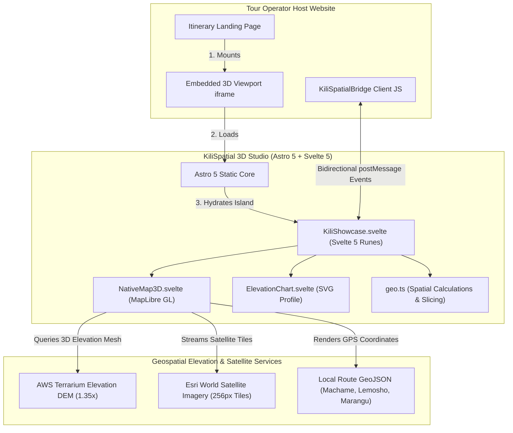

# 🏔️ KiliSpatial — 3D Mount Kilimanjaro B2B Showcase & Embedding Studio

<p align="center">
  
  
  
  
  
  
  
</p>

<p align="center">
  <a href="https://wa.me/255692654000">
    
  </a>
  <a href="mailto:clevengodsontech@gmail.com">
    
  </a>
</p>

---

A production-ready, extensible **3D Mount Kilimanjaro interactive trekking showcase and B2B embedding studio** for safari and tour operators. Powered by **Astro 5**, **Svelte 5 (Runes)**, **MapLibre GL 3D terrain**, and **Tailwind CSS v4**.

**Free core for everyone + paid Pro upgrades for luxury tour operators, live satellite GPS tracking, and multi-park East Africa spatial corridor mapping.**

> **Current status**: `v1.0.0` — Production-ready professional release.

---

## ✨ Key Features (Free Open Source Core)

- 🏔️ **Native 3D WebGL Terrain Mesh** — Photorealistic 3D topography of Mount Kilimanjaro powered by MapLibre GL, AWS Terrarium DEM raster tiles (`exaggeration: 1.35`), and high-resolution Esri World Satellite imagery.
- 📍 **Point-to-Point Stage Illumination** — Dynamic GPS trail slicing displaying exact departure waypoints (Point A) and destination camps (Point B), illuminated by vibrant glowing neon emerald ribbons (`#10b981`) and sharp core lines (`#ffffff`).
- 🔭 **Summit-Oriented Close-Up Zoom** — Deep camera zooms (`zoom: 15.0`, `pitch: 70°`) calculating bearings directly toward Uhuru Peak (5,895m) to visualize steep volcanic ridges, valleys, and cliffs (e.g. Barranco Wall, Lava Tower).
- 🥾 **Interactive Expedition Itinerary Drawer** — Day-by-day scrollytelling cards detailing individual "FROM" / "TO" waypoints, elevation gains/losses, trekking hours, and ecological zones.
- 🎛️ **Uncluttered 3D Viewport Workspace** — 100% full-height layout with zero dead vertical space. Heavy flight controls deck is **hidden by default** in favor of a sleek floating glass action pill and collapsible SVG elevation chart.
- ⚡ **Bidirectional postMessage SDK Bridge** — Resilient, queue-safe two-way communication bridge between host tour operator websites and the embedded 3D viewer.
- 📋 **B2B Embed Code Generator** — Interactive configurator allowing tour companies to customize parameters (`route`, `day`, `drone`, `chart`) and copy embed snippets (`<iframe>` or JavaScript SDK).
- 📱 **Responsive & Mobile Optimized** — Smooth touch gestures and camera control across desktop, tablet, and mobile browsers.

---

## 🚀 Pro / Enterprise Features (Commercial Upgrades)

The open-source version is fully functional for developers, independent operators, and regional agencies. 

For high-volume tour operators, luxury safari brands, and national tourism boards, we provide commercial licenses, custom spatial development, and turnkey integrations:

### 🏷️ 1. White-Label Branding & Domain Masking
- Complete removal of KiliSpatial watermarks.
- Custom corporate typography, brand colors, custom map markers, and branded elevation SVG profiles.
- Custom domain / reverse proxy embedding (e.g. `expeditions.yourluxurytrek.com`).

### 🛰️ 2. Live Satellite Crew & Client Tracking
- Real-time GPS synchronization with **Garmin inReach**, **SPOT Gen4**, or **Zoleo** satellite communicators.
- Live 3D position marker of the climbing group on the mountain for family members and expedition HQ.
- Automated daily check-in pings and emergency alert status.

### 🗺️ 3. Multi-Mountain & Safari Wildlife Corridors
- **Mount Meru (4,562m)**: Complete 3D caldera, ash cone, and Socialist Peak trek simulator.
- **Ol Doinyo Lengai (2,962m)**: Active stratovolcano ("Mountain of God") steep ascent mapping.
- **Rwenzori Mountains & Mount Kenya**: Alpine peaks across East and Central Africa.
- **Serengeti Wildlife Migration Corridors**: 3D spatial tracking of wildebeest herds through the Mara River and Grumeti crossings.

### 🔌 4. CRM & Tour Booking Engine Connectors
- Direct integration with **SafariBookings**, **Wetu**, **Peek Pro**, and **FareHarbor**.
- Automatic lead capture syncing into **HubSpot**, **Salesforce**, or **Pipedrive** when clients explore specific route itineraries.
- Embedded quote calculator and checkout flows.

### 🖥️ 5. High-Resolution Interactive Expo Displays (Kiosk Mode)
- Ultra-high-resolution (4K/8K) touch-kiosk presentation mode for international travel trade expos (**ITB Berlin**, **WTM London**, **Indaba Durban**).
- Automated idle-loop cinematic flythrough demo with physical controller or touch gestures.

> For Pro licensing, custom integrations, or enterprise deployment, please contact us directly (see [Contact](#-contact) section).

---

## 📋 Table of Contents

- [Quick Start](#-quick-start)
- [Architecture](#️-architecture)
- [Configuration](#-configuration)
- [Usage & Embed SDK](#-usage--embed-sdk)
- [Project Structure](#-project-structure)
- [Development Commands](#-development)
- [Production Deployment](#-production-deployment)
- [Contributing](#-contributing)
- [Roadmap](#-roadmap)
- [Support](#-support-this-project)
- [Contact](#-contact)
- [About the Author](#-about-cleven)
- [License](#-license)

---

## 🚀 Quick Start

### Prerequisites
- **Node.js**: `v22.0.0+`
- **pnpm**: `v10+` (or `npm`)
- **Docker** (optional, for containerized run)

### 1. Clone the repository
```bash
git clone https://github.com/cleven12/kilispatial-mvp.git
cd kilispatial-mvp
```

### 2. Setup Environment
```bash
cp .env.example .env
```

### 3. Install Dependencies & Start Dev Server
```bash
pnpm install
pnpm dev
```
Open **[http://localhost:4321](http://localhost:4321)** in your browser.

### 4. (Optional) Run with Docker
```bash
docker compose up -d --build
```
Access the production build at **[http://localhost:4321](http://localhost:4321)**.

---

## 🏗️ Architecture



---

## ⚙️ Configuration

All configuration lives in `.env` (refer to `.env.example`).

| Variable | Description | Default |
| :--- | :--- | :--- |
| `PUBLIC_KILI_ORIGIN` | Remote 3D engine origin URL for iframe synchronization | `https://kili.xenohuru.com` |
| `PORT` | Local dev server port | `4321` |
| `HOST` | Local host interface | `localhost` |
| `VITE_EMBED_ORIGINS` | Permitted origins for remote CSP whitelist headers | `http://localhost:4321,https://yourdomain.com` |

---

## 💬 Usage & Embed SDK

### 1. Simple Responsive `<iframe>` Embed
Add this snippet to your itinerary page or WordPress CMS:

```html
<div style="position: relative; width: 100%; height: 650px; border-radius: 16px; overflow: hidden; box-shadow: 0 20px 25px -5px rgba(0, 0, 0, 0.5);">
  <iframe
    src="https://kili.xenohuru.com/embed?route=machame&day=1&drone=0"
    title="Mount Kilimanjaro 3D Expedition Itinerary"
    style="width: 100%; height: 100%; border: 0;"
    allow="fullscreen"
    loading="lazy"
  ></iframe>
</div>
```

### 2. Full Two-Way Synchronization via JavaScript SDK
Synchronize your website's scrollytelling or itinerary accordions with the 3D camera:

```typescript
import { KiliSpatialBridge } from './src/lib/kilispatial';

const iframe = document.querySelector('iframe') as HTMLIFrameElement;
const bridge = new KiliSpatialBridge(iframe, 'https://kili.xenohuru.com');

// Listen for 3D camera and waypoint events
bridge.listen((event) => {
  if (event.type === 'day') {
    console.log(`Climber focused Day ${event.day}`);
  } else if (event.type === 'place') {
    console.log(`Climber hovered waypoint: ${event.id}`);
  }
});

// Control 3D viewport from host buttons
document.getElementById('btn-day-3')?.addEventListener('click', () => {
  bridge.send({ type: 'focusDay', day: 3 });
});

document.getElementById('btn-lava-tower')?.addEventListener('click', () => {
  bridge.send({ type: 'focusPlace', id: 'lava-tower' });
});
```

---

## 📁 Project Structure

```text
kilispatial-mvp/
├── .github/
│   ├── ISSUE_TEMPLATE/        # Structured Bug, Feature & Enterprise forms
│   ├── workflows/ci.yml       # GitHub Actions automated build CI pipeline
│   ├── CODEOWNERS             # Repository code owner (@cleven12)
│   ├── FUNDING.yml            # Sponsorship & donation links
│   └── PULL_REQUEST_TEMPLATE  # Contribution pull request checklist
├── public/
│   └── data/
│       ├── places.json        # 33 Kilimanjaro camps, gates, huts & summits
│       └── routes/            # GPS traces for all routes (Machame, Lemosho, Marangu, etc.)
├── src/
│   ├── components/
│   │   ├── NativeMap3D.svelte # MapLibre GL 3D WebGL engine & camera flythroughs
│   │   ├── KiliShowcase.svelte# Svelte 5 Studio workspace & flight control deck
│   │   ├── ElevationChart.svelte # Docked SVG elevation profile chart
│   │   └── EmbedModal.svelte  # B2B Embed code snippet configurator
│   ├── lib/
│   │   ├── geo.ts             # Spatial calculations, haversine & stage slicing
│   │   ├── kilispatial.ts     # PostMessage SDK bridge & command queuing
│   │   └── routes-data.ts     # Route itineraries, zones, and difficulty metadata
│   ├── layouts/
│   │   └── Layout.astro       # HTML shell & font optimizations
│   └── pages/
│       └── index.astro        # Studio entry point
├── .editorconfig              # Cross-editor formatting consistency
├── .env.example               # Environment variables template
├── CHANGELOG.md               # Version history and release notes
├── CODE_OF_CONDUCT.md         # Contributor Covenant v2.1
├── CONTRIBUTING.md            # Guidelines for open-source contributors
├── Dockerfile                 # Multi-stage production container
├── docker-compose.yml         # Containerized local orchestration
├── Makefile                   # Convenient developer commands
├── package.json               # Dependencies & project metadata
├── README.md                  # Flagship documentation
├── ROADMAP.md                 # Product milestones (Free vs Pro)
├── SECURITY.md                # Vulnerability disclosure policy
└── tsconfig.json              # TypeScript strict configuration
```

---

## 🛠️ Development

### Handy Makefile Commands
```bash
make help          # Show all available make targets
make install       # Install dependencies with pnpm
make dev           # Start Astro development server
make build         # Compile production bundle
make preview       # Preview production build locally
make docker-build  # Build Docker container
make docker-up     # Launch containerized service
```

---

## 🚢 Production Deployment

### Vercel / Netlify / Cloudflare Pages
KiliSpatial is built as a static Astro output (`output: 'static'`) and deploys out of the box to any modern edge hosting platform:
- **Build Command**: `pnpm build`
- **Output Directory**: `dist`
- **Node Version**: `>=22`

---

## 🤝 Contributing
Contributions from the open-source community are warmly welcomed! Please check out [CONTRIBUTING.md](CONTRIBUTING.md) to get started.

---

## 🗺️ Roadmap
See [ROADMAP.md](ROADMAP.md) for our product roadmap, including upcoming free open-source releases and enterprise commercial solutions.

---

## 💖 Support This Project
If KiliSpatial saves your agency time, enhances your safari proposals, or serves as a helpful geospatial reference:
- ⭐ **Star this repository on GitHub**
- 📢 **Share it with fellow developers and tour operators**
- 🤝 **Sponsor development via GitHub Sponsors or direct partnership**

---

## 📬 Contact

For commercial licensing, custom mountain mapping (Mount Meru, Ol Doinyo Lengai), live satellite tracking integrations, or enterprise inquiries:

- **Founder & Maintainer**: Cleven
- **Email**: [clevengodsontech@gmail.com](mailto:clevengodsontech@gmail.com)
- **WhatsApp**: [+255 692 654 000](https://wa.me/255692654000)
- **GitHub**: [@cleven12](https://github.com/cleven12)

*We typically respond within 24 hours.*

---

## 🌍 About Cleven

**Cleven** is a full-stack and geospatial software engineer based in Tanzania, specializing in interactive 3D WebGL visualizations, AI-driven automation, and modern web architectures for Africa's travel, tourism, and geospatial sectors.

---

## 📄 License

This project is licensed under the [MIT License](LICENSE) — see the LICENSE file for details.

Made with ❤️ in Tanzania by **Cleven**
